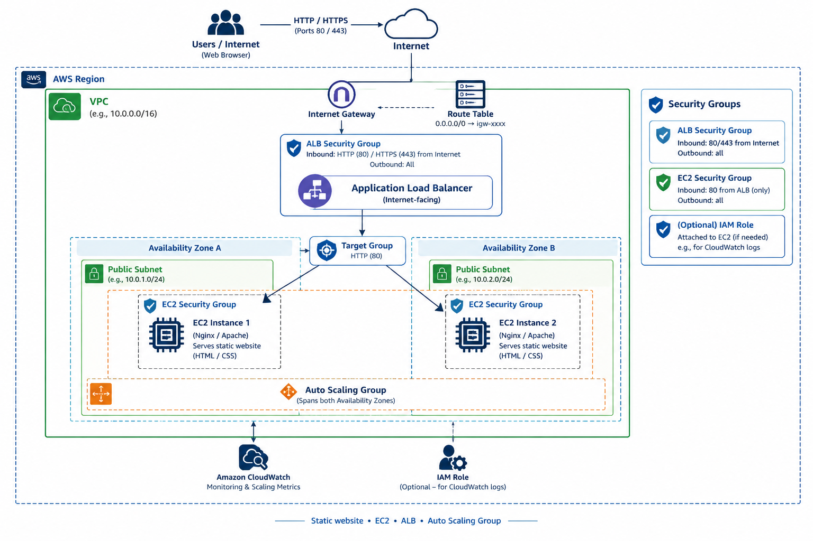

# AWS EC2 Auto Scaling with Application Load Balancer

## Project Overview

This project demonstrates hosting a static website on Amazon EC2 instances behind an Application Load Balancer (ALB), with an Auto Scaling Group (ASG) to manage EC2 capacity automatically.

The AWS resources were configured manually using the AWS Management Console.

## Architecture

**Request flow:**

User → Application Load Balancer → Target Group → EC2 Instances

The Auto Scaling Group manages the EC2 instances based on the configured scaling policies.

## AWS Services Used

- **Amazon EC2:** Hosts the static website.
- **Application Load Balancer:** Distributes incoming HTTP traffic.
- **Target Group:** Routes requests to registered EC2 instances and performs health checks.
- **Auto Scaling Group:** Manages the number of EC2 instances according to configured scaling policies.
- **Amazon CloudWatch:** Monitors metrics used for scaling decisions.
- **Amazon VPC:** Provides networking and security for the resources.
- **Security Groups:** Control inbound and outbound traffic.

## Implementation

1. Created the required AWS networking and security configurations.
2. Launched EC2 instances and deployed the static website.
3. Configured a target group and registered the EC2 instances.
4. Created an internet-facing Application Load Balancer.
5. Configured an Auto Scaling Group with the required capacity settings.
6. Configured scaling policies and CloudWatch monitoring.
7. Accessed the website through the ALB DNS name.
8. Tested the Auto Scaling behavior and recorded the scale-in demonstration.

## Auto Scaling Demonstration

### Scale-In Test — Recorded

The scale-in demonstration was recorded during testing.

- Accessed the website through the Application Load Balancer.
- Observed the Auto Scaling Group and its EC2 instance capacity.
- During the test, the load was insufficient to trigger scale-out.
- Recorded the scale-in behavior observed during the demonstration.

**Note:** Scale-out was not triggered during this test because the configured scaling conditions were not met. This does not mean scale-out is unsupported; it means it was not demonstrated under the test conditions.

### Demo Video

**Video location in this repository:**

`01-ec2-alb-auto-scaling/videos/auto-scaling-demo.mp4`

[Watch the Auto Scaling Demo](videos/auto-scaling-demo.mp4)

## Validation

- Verified website access through the ALB DNS name.
- Checked target group health status.
- Reviewed EC2 instance capacity in the Auto Scaling Group.
- Observed and recorded the scale-in behavior.

## Security Considerations

- Use security groups to restrict access to required ports.
- Allow public HTTP traffic through the ALB as required.
- Restrict direct access to EC2 instances so website traffic comes through the ALB.
- Avoid exposing unnecessary ports to the internet.

## Key Learnings

- Deploying a static website on EC2.
- Configuring an Application Load Balancer and target group.
- Configuring an Auto Scaling Group and scaling policies.
- Understanding CloudWatch metrics and scaling triggers.
- Monitoring and validating scale-in behavior.

## Project Information

- **Project Type:** AWS Cloud / Infrastructure
- **Provisioning Method:** AWS Management Console
- **Website Type:** Static Website
- **Status:** Implemented; scale-in demonstration recorded, scale-out not triggered during the test.
