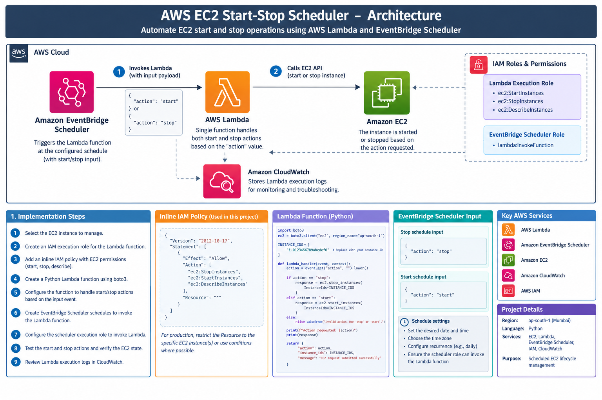

# Automated EC2 Start and Stop Using AWS Lambda and EventBridge Scheduler

## Project Overview

This project demonstrates how to automate Amazon EC2 instance start and stop operations using **AWS Lambda, Amazon EventBridge Scheduler, Python, and IAM**.

A single Lambda function handles both operations. EventBridge Scheduler invokes the function at configured times and passes a JSON input specifying whether the EC2 instance should start or stop.

This automation helps reduce unnecessary EC2 running costs by stopping instances when they are not required and starting them when needed.

## Architecture



### Architecture Workflow

1. Amazon EventBridge Scheduler triggers the Lambda function according to the configured schedule.
2. The scheduler passes an input payload containing the action: `start` or `stop`.
3. AWS Lambda executes the Python function.
4. The function uses the AWS SDK for Python (`boto3`) to call the appropriate EC2 API.
5. The Lambda execution role grants the required EC2 permissions.
6. The Scheduler execution role grants EventBridge Scheduler permission to invoke the Lambda function.
7. Amazon CloudWatch Logs records the Lambda execution output for troubleshooting.

## AWS Services Used

| Service | Purpose |
|---|---|
| Amazon EC2 | Virtual server to start and stop |
| AWS Lambda | Executes the Python automation |
| Amazon EventBridge Scheduler | Triggers Lambda on a schedule |
| AWS IAM | Controls permissions between AWS services |
| Amazon CloudWatch | Stores Lambda execution logs |

## Project Structure

```text
03-ec2-start-stop-scheduler/
├── README.md
├── lambda/
│   └── ec2_start_stop.py
├── iam/
│   └── ec2-start-stop-policy.json
├── docs/
│   └── architecture.png
└── screenshots/
    ├── lambda-function.png
    ├── eventbridge-start-schedule.png
    ├── eventbridge-stop-schedule.png
    └── ec2-instance-state.png
```

## Implementation Steps

### Step 1: Create an EC2 Instance

1. Open the Amazon EC2 console.
2. Launch an EC2 instance in your selected AWS Region.
3. Record the instance ID.
4. Ensure the instance is in a state suitable for testing start and stop operations.

For the sample Lambda code, the Region is `ap-south-1` (Asia Pacific — Mumbai). Update it if your instance is in another Region.

### Step 2: Create an IAM Role for Lambda

1. Open **IAM → Roles → Create role**.
2. Select **AWS service** as the trusted entity.
3. Select **Lambda** as the use case.
4. Create the role.
5. Attach permissions for the EC2 operations and CloudWatch logging.
6. Name the role `ec2-start-stop-lambda-role`.

The role needs permissions for:
- `ec2:StartInstances`
- `ec2:StopInstances`
- `ec2:DescribeInstances`
- CloudWatch Logs actions required for Lambda logging

For a production setup, restrict EC2 actions to the intended instance resources wherever supported.

### Step 3: Create the Lambda Function

1. Open **AWS Lambda → Create function**.
2. Choose **Author from scratch**.
3. Function name: `ec2-start-stop-function`.
4. Runtime: Python.
5. Select the IAM role created in Step 2.
6. Create the function.

### Step 4: Add the Python Code

Create `lambda/ec2_start_stop.py` in your GitHub project and use the following code in the Lambda console.

```python
import json
import boto3

REGION = "ap-south-1"
INSTANCE_IDS = ["i-0123456789abcdef0"]  # Replace with your EC2 instance ID

ec2 = boto3.client("ec2", region_name=REGION)


def lambda_handler(event, context):
    action = event.get("action", "").lower()

    if action == "start":
        response = ec2.start_instances(
            InstanceIds=INSTANCE_IDS
        )
        message = "EC2 start request submitted successfully"

    elif action == "stop":
        response = ec2.stop_instances(
            InstanceIds=INSTANCE_IDS
        )
        message = "EC2 stop request submitted successfully"

    else:
        raise ValueError(
            "Invalid action. Use 'start' or 'stop'."
        )

    print(json.dumps(response, default=str))

    return {
        "statusCode": 200,
        "body": json.dumps({
            "message": message,
            "action": action,
            "instance_ids": INSTANCE_IDS
        })
    }
```

**Important:** Replace `i-0123456789abcdef0` with your actual EC2 instance ID before testing. The messages indicate that the API request was submitted, not necessarily that the instance has finished transitioning to its new state.

Click **Deploy** after adding the code.

### Step 5: Test the Lambda Function

Create a test event with the following input to start the instance:

```json
{
  "action": "start"
}
```

Create another test event to stop the instance:

```json
{
  "action": "stop"
}
```

Run each test and review the execution result. Verify the EC2 instance state in the EC2 console.

### Step 6: Create an IAM Role for EventBridge Scheduler

The Scheduler requires its own execution role to invoke Lambda. The Lambda role and Scheduler role have different responsibilities.

1. Open **IAM → Roles → Create role**.
2. Choose **Custom trust policy** if required to configure the Scheduler service principal.
3. Configure the trust relationship to allow `scheduler.amazonaws.com` to assume the role.
4. Attach a policy allowing `lambda:InvokeFunction` on your specific Lambda function.
5. Name the role `eventbridge-scheduler-lambda-role`.

The role's trust policy must allow the EventBridge Scheduler service to assume it. The permissions policy must allow invocation of the intended Lambda function.

### Step 7: Create the EC2 Start Schedule

1. Open **Amazon EventBridge → Scheduler → Create schedule**.
2. Enter a schedule name, such as `ec2-start-schedule`.
3. Select the appropriate schedule type.
4. Configure the desired date and time or recurring schedule.
5. Select **AWS Lambda Invoke** as the target.
6. Choose `ec2-start-stop-function`.
7. Set the target input to:

```json
{
  "action": "start"
}
```

8. Select `eventbridge-scheduler-lambda-role` as the execution role.
9. Create the schedule.

### Step 8: Create the EC2 Stop Schedule

Repeat Step 7, but use a different schedule name, such as `ec2-stop-schedule`.

Set the target input to:

```json
{
  "action": "stop"
}
```

Choose the appropriate time for stopping the instance and use the Scheduler execution role.

**Important:** EventBridge Scheduler uses the schedule's configured time zone. Check the time zone and recurrence settings carefully before enabling the schedules.

### Step 9: Verify the Automation

1. Open the EventBridge Scheduler console and confirm both schedules are enabled.
2. Check the Lambda function's monitoring and CloudWatch Logs.
3. Confirm that the correct action is passed to Lambda.
4. Open the EC2 console and verify the instance state after each scheduled operation.
5. If an operation fails, review IAM permissions, the Lambda logs, the instance ID, the Region, and the schedule's execution role.

## Security Best Practices

- Never commit AWS access keys, secret keys, or credentials to GitHub.
- Replace example instance IDs with your own lab instance IDs.
- Use separate IAM roles for Lambda execution and EventBridge Scheduler execution.
- Apply least-privilege permissions rather than granting unnecessary access to all EC2 instances.
- Review CloudWatch Logs for errors and unexpected behavior.
- Disable or delete schedules when the automation is no longer required.

## Troubleshooting

| Problem | What to check |
|---|---|
| Scheduler cannot invoke Lambda | Scheduler execution role trust policy and `lambda:InvokeFunction` permission |
| Lambda returns `AccessDenied` | Lambda execution role's EC2 permissions |
| Instance ID is invalid | Confirm the instance ID and Region |
| Lambda fails during execution | Review CloudWatch Logs and the test event |
| Instance does not start or stop | Check the current EC2 state and the API error |
| Schedule runs at the wrong time | Check the configured time zone and schedule expression |

## Learning Outcomes

By completing this project, I gained practical experience with:

- AWS Lambda and Python automation.
- EventBridge Scheduler configuration.
- IAM trust policies and execution permissions.
- EC2 start and stop API operations using `boto3`.
- CloudWatch Logs and troubleshooting.
- Scheduling cloud operations to help manage AWS resource usage.
  
Cloud and DevOps learner | AWS | Linux | Python | Automation | CI/CD
